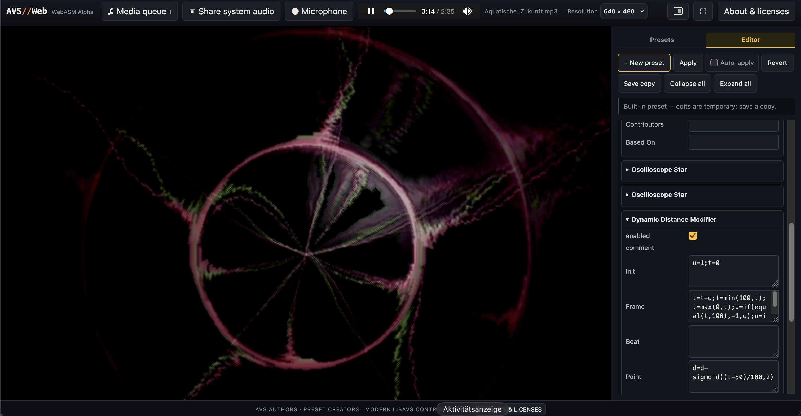

# AVS//Web — native renderer alpha

This build runs the original AVS C/C++ renderer in WebAssembly and opens legacy
binary `.avs` presets directly. This milestone adds a schema-driven basic editor;
native APE plug-ins remain intentionally deferred.



## Credits and source foundation

The renderer is based on grandchild/vis_avs, the modern C++ AVS port and libavs
library, at revision `1cee1f3`: [grandchild/vis_avs](https://github.com/grandchild/vis_avs).
Credit for that foundation belongs to grandchild and the other upstream
contributors, building on the original AVS by Justin Frankel and other Nullsoft
contributors. AVS//Web adds the browser adaptation and UI.

See [CREDITS.txt](CREDITS.txt) for attribution, [SOURCE-NOTICE.txt](SOURCE-NOTICE.txt) for web-port modifications,
and [THIRD-PARTY-NOTICES.txt](THIRD-PARTY-NOTICES.txt) for dependency notices. The modern port's upstream
BSD 3-Clause license is reproduced verbatim in [LICENSE-AVS.txt](LICENSE-AVS.txt); individual
dependencies and legacy presets retain their own license status.

## Preset authors / takedown

The bundled presets were collected from publicly available legacy sources and
were created by their respective authors, not by this project. If you authored
a bundled preset or AVS component and want it removed, email
[mo@max-hirschfluss.de](mailto:mo@max-hirschfluss.de). Takedown requests will be handled promptly.

Bundled presets are optional and live separately in `presets/bundled-presets.js`.
The app continues to work with only “New preset” if that module is deleted. Each
preset is stored as one record per line so an individual preset can be removed
without changing application code. Entries known to require unsupported APE
effects are not included.

## Build and run

The project builds both the editable C++ renderer and the web interface locally.
Use **Node.js 24.11.0** (pinned in `.nvmrc`), npm, and Python 3. Vite is pinned to
**8.3.6**. The compiler is **Emscripten 4.0.15**, pinned in `package.json` and the
local devDependency `@avs-web/emscripten-toolchain` at `vendor/emsdk-4.0.15/`.

Initial setup:

```sh
nvm use
npm ci
npm run setup:wasm
```

`setup:wasm` uses the vendored, official emsdk installer to download and activate
exactly 4.0.15 into the ignored project-local `.cache/emsdk/` directory. It installs
compiler binaries and supporting tools; it does not change your global compiler
or shell configuration. This large download is needed only once per checkout.
The npm registry supplies Vite and its locked dependencies; the local toolchain
package uses the official Emscripten SDK installer. Set `PYTHON` to a Python 3 executable if it is not named `python3`.

```sh
npm run dev       # Compile C++/WASM, run renderer checks, start Vite
npm run build     # Compile C++/WASM, run renderer checks, bundle into dist/
npm run preview   # Serve the production bundle
```

Open [http://127.0.0.1:8080/](http://127.0.0.1:8080/). `npm ci` installs the exact
dependency tree in `package-lock.json`. Vite supports Node 20.19+ or 22.12+, but
Node 24 is the tested project version; Node 16 is too old.

Edit native renderer code in `native/avs/` and the browser adapter in `native/web/`.
`npm run build:wasm` recompiles the renderer into `build/native/` and runs targeted
checks covering schema, waveform rendering, colors, legacy serialization, metadata,
root settings, beat response to externally supplied PCM, and EEL execution.
Compilation is incremental and notices source/header changes. When Vite is already
running, rerun `npm run build:wasm` after C++ edits, then reload the page.
`npm run check:wasm` reruns those checks without compiling.

`dist/` contains the complete static app, optional presets, licenses, credit/source
notices, this README, its screenshot, and the legacy `app/index.html` redirect.
Copy the **contents of `dist/`** to an HTTP host; relative assets support subdirectory
hosting. The source checkout requires Vite; the production output needs only HTTP:

```sh
python3 -m http.server 8080 --bind 127.0.0.1 --directory dist
```

On Windows use `py -3` instead of `python3`. The included `start-server.sh` and
`start-server.bat` serve `dist/` from a source checkout, or their own directory when
included in the built distribution. They require an existing production build.
Opening `index.html` via `file://` does not work because of the module worker and
WebAssembly. Use the HTTP URL if an “Open in” action opens a local file URL.

### GitHub Pages deployment

The repository's `.github/workflows/static.yml` installs the pinned Node.js and
Emscripten toolchain, runs `npm ci` and `npm run build`, and publishes the resulting
`dist/` contents under `AVS-Web-Native-Editor-Alpha/`. Other tracked projects and
the repository index are preserved in the Pages artifact.

`dist/`, `build/`, and `.cache/` stay ignored by Git: Actions generates them on the
runner before uploading the Pages artifact. No local build or committed binaries
are needed for deployment. Publishing the source checkout directly will not work;
Vite must resolve its worker and `?url` asset imports first.

## Project layout

- `index.html`: Vite's HTML entry point.
- `src/app.js`: UI, editor, audio integration, and worker coordination.
- `src/avs-worker.js`: worker-side renderer integration.
- `src/styles/`: application stylesheets.
- `native/`: editable C++ renderer, browser adapter, and native build script.
- `vendor/`: pinned official Emscripten SDK installer and local npm wrapper.
- `scripts/`: build and verification helpers.
- `presets/` and `docs/`: optional preset collection and documentation assets.
- `build/native/` and `dist/`: generated native artifacts and production website,
  both ignored by Git.

Vite bundles the UI, worker, and CSS for production. The generated Emscripten
loader and WASM remain separate assets and are copied without rewriting their bytes.

## Adaptations to the AVS fork

AVS//Web adapts the C++ renderer from `grandchild/vis_avs` for WebAssembly:

- Portable rendering paths and the architecture-neutral WDL-EEL2 interpreter,
  with an 8 MiB WASM stack and initialized EEL global RAM and callbacks.
- The original waveform-level beat detector adapted for external Web Audio PCM,
  with separate 1024-sample FFT and 576-sample legacy waveform buffers.
- Fixes for root configuration swapping, `#RRGGBB` colors, and metadata absent
  from legacy presets.
- A browser API and single-worker platform layer for audio input, rendering,
  isolated preset loading, schema access, and legacy serialization.

The editable sources are in `native/avs/` and `native/web/`.
`native/web-port.patch` records the initial upstream changes, already applied to
those sources. Native APE implementations remain excluded. See
[native/README.md](native/README.md) for implementation and build details.

## Source versions and checksums

The source basis is
[`grandchild/vis_avs` at `1cee1f3d4f783b830538c3e4d2082a2c59521dee`](https://github.com/grandchild/vis_avs/tree/1cee1f3d4f783b830538c3e4d2082a2c59521dee).
Its renderer and bundled dependency sources are included under `native/avs/` with
their original notices. `native/upstream.json` records the source archive's SHA256.
The application builds its JS/WASM from these sources; precompiled historical
artifacts are not required.

The official **Emscripten 4.0.15** SDK installer archive has SHA256
`35be7626493e3bd22860ee2177147f9bca3b6ff871edeab27c5b061a9ed9d23d`.
Its vendored files are individually recorded in
`vendor/emsdk-4.0.15/provenance.json`; `npm run verify:vendor` checks them.

Each native build records the compiler version, current JS/WASM SHA256 values,
and native source-tree hash in `build/native/provenance.json`. The production
bundle includes the same information as `dist/renderer-provenance.json`.

## Audio

Use “Media file” or drop an audio or video file anywhere. For video files, the
audio track drives AVS while the compact player remains audio-only. “Share system
audio” uses the browser's screen/tab picker when the browser supports an audio
track. “Microphone” is the fallback when the browser cannot expose system or
other-app audio. Audio never leaves the browser.

If the browser exposes screen sharing without a usable audio track, the app reports
that system audio is unsupported and leaves file playback and the renderer usable.

The browser signal is normalized independently of playback volume. The native port
also runs AVS's original waveform-level beat detector on the supplied audio.

## Editor

“New preset” is pinned at the top of the preset list and creates the default minimal
purple waveform preset, effectively clearing the current preset. It is selected on startup.
The separate “Clear every frame” checkbox is the original rendering setting and takes
effect after Apply. Optional Auto-apply is off by default and disables the manual Apply
button while active. Preset settings and components use compact dark accordions.

Date Initial and Date Last are display-only. Legacy binary presets do not contain the
initial-date metadata, so it is intentionally shown as empty instead of receiving a
synthesized date. Built-in preset comments are also display-only, and built-in presets
are downloaded with “ - edited” in the filename rather than overwritten.

For built-in legacy presets, Comment components are shown first as attribution and are
entirely read-only: they cannot be edited, disabled, or removed from within the app.

The header resolution selector offers Auto, 320×240, 640×480 and 800×600. Lower
fixed resolutions can substantially reduce CPU use for complex presets.

## Known alpha limitations

* Native APE plug-ins are skipped safely.
* Presets known to contain unsupported APE/unknown components are omitted.
* The Editor tab can edit supported fields and add/remove components. Apply
  validates changes through libavs; Save writes a legacy binary .avs file.
* Saving without applying changes preserves the original preset bytes exactly.
* Picture/video effects cannot yet resolve external media files.
* The mixed legacy preset collection has not been exhaustively regression-tested.

Normalization improves quiet material but deliberately does not alter the sound you
hear.

See About & licenses inside the app and the included license files.
